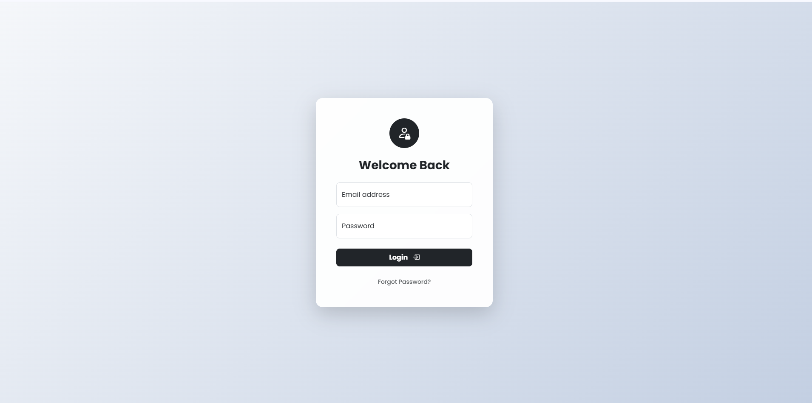
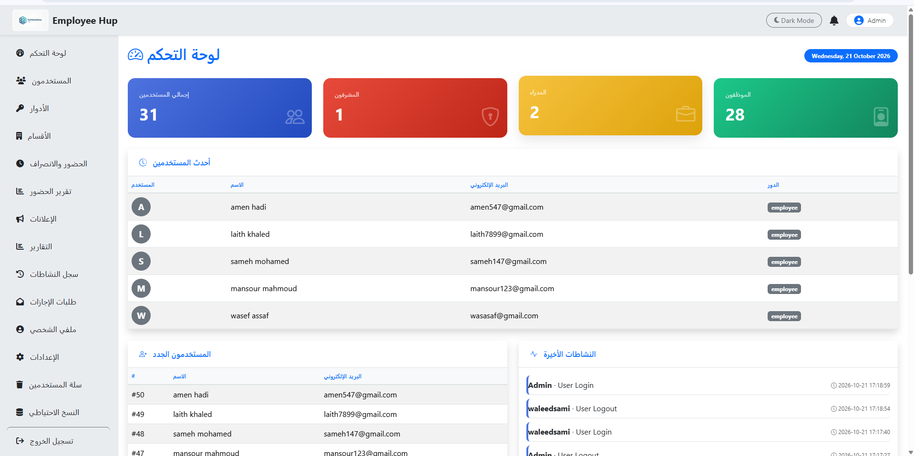
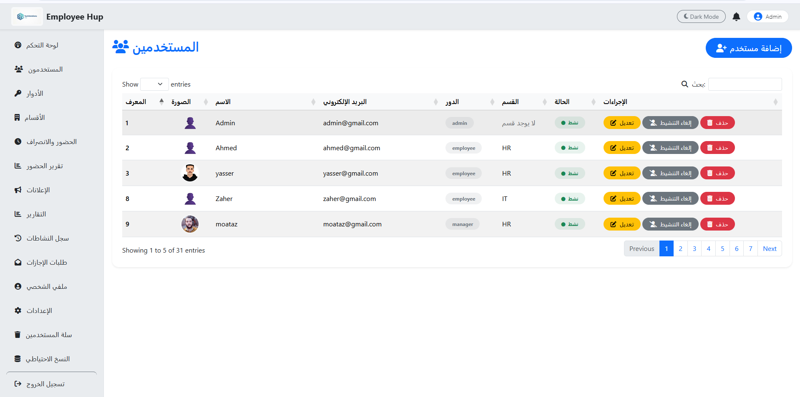
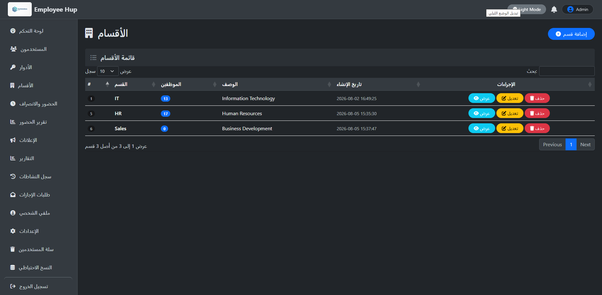
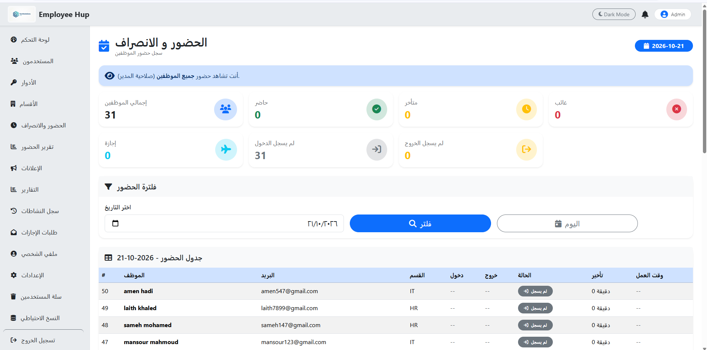
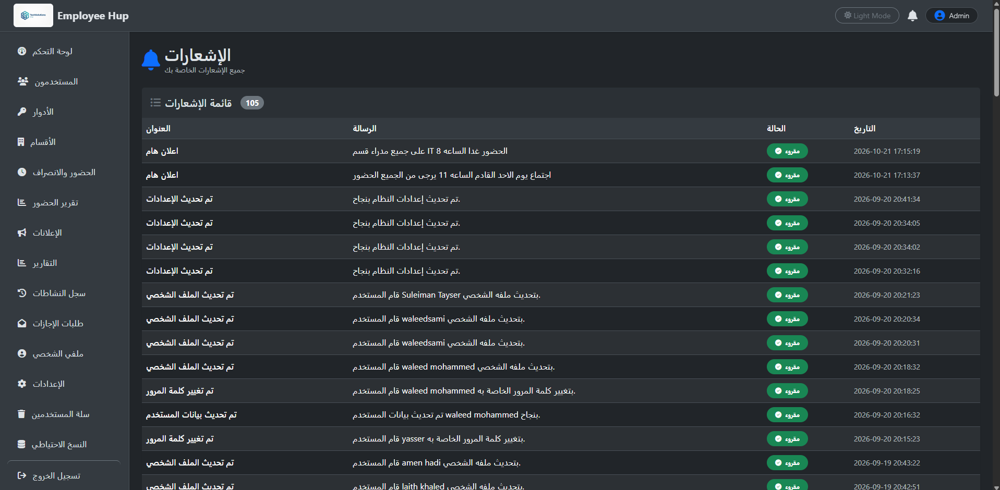
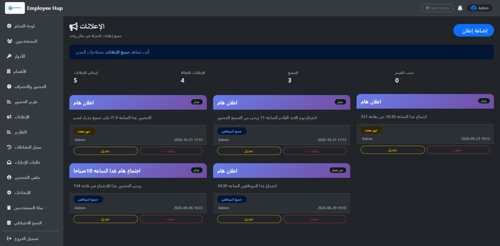
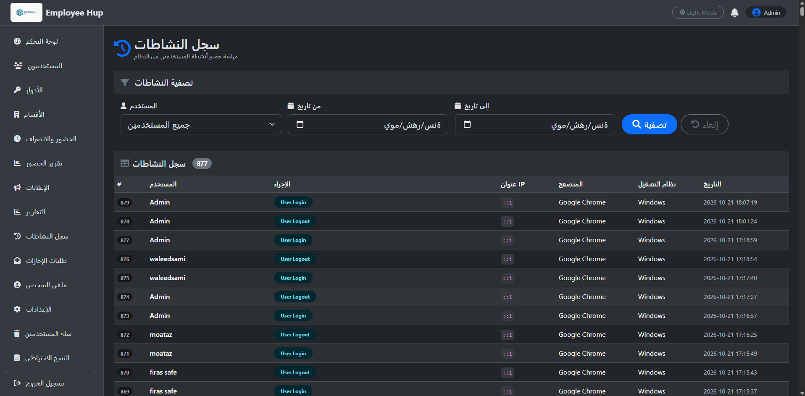
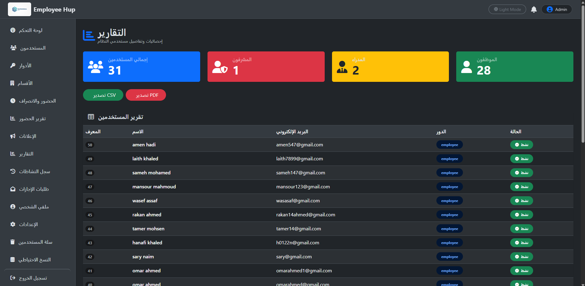

🏢 نظام إدارة الموظفين — Employee Management System

نظام ويب لإدارة الموظفين والأقسام والأدوار والصلاحيات والحضور والانصراف والإجازات والإشعارات والإعلانات وسجل الأنشطة، من خلال لوحة تحكم مركزية مبنية باستخدام PHP وMySQL وPDO وBootstrap 5 وJavaScript.

📌 نبذة عن المشروع

نظام إدارة الموظفين هو تطبيق ويب يهدف إلى تنظيم العمليات الإدارية المتعلقة بالموظفين داخل المؤسسة، وتسهيل إدارة بياناتهم ومتابعة الحضور والإجازات والتحكم في الوصول إلى وظائف النظام.

يعتمد النظام على نظام الأدوار والصلاحيات (Role-Based Access Control - RBAC)، بحيث يتم تحديد الصفحات والعمليات التي يمكن لكل مستخدم الوصول إليها وفقًا لدوره والصلاحيات الممنوحة له.

👤 أدوار المستخدمين

🔴 المدير العام (Admin)

يمتلك صلاحيات إدارية واسعة وفقًا لإعدادات النظام، ومنها:

* إدارة المستخدمين.
* إدارة الأقسام.
* إدارة الأدوار والصلاحيات.
* إدارة الإعلانات.
* متابعة إحصائيات النظام.
* مشاهدة سجل الأنشطة.
* إدارة إعدادات النظام والوظائف الإدارية المتاحة.

🟡 المدير (Manager)

يستطيع متابعة الموظفين ضمن القسم التابع له، وفقًا للصلاحيات الممنوحة له، ومنها:

* مشاهدة موظفي قسمه.
* متابعة حضور موظفي قسمه.
* مشاهدة طلبات الإجازات ومراجعتها.
* الموافقة على طلبات الإجازة أو رفضها إذا كانت الصلاحية متاحة.
* الوصول إلى الصفحات والوظائف المسموحة له فقط.

🟢 الموظف (Employee)

يستطيع، وفقًا للصلاحيات المتاحة له:

* مشاهدة ملفه الشخصي وتعديله.
* تسجيل الحضور والانصراف.
* مشاهدة سجل حضوره الخاص.
* تقديم طلبات الإجازة ومتابعة حالتها.
* مشاهدة الإشعارات.
* مشاهدة الإعلانات الموجهة إليه.

⸻

## 📸 لقطات الشاشة (Screenshots)

### 🔐 صفحة تسجيل الدخول


### 📊 لوحة التحكم — الوضع الفاتح


### 🌙 لوحة التحكم — الوضع الداكن


### 👥 إدارة المستخدمين


### 🔑 الأدوار والصلاحيات


### 🏢 إدارة الأقسام


### 🕒 الحضور والانصراف


### 📝 طلبات الإجازات


### 🔔 الإشعارات


### 📢 الإعلانات


### 📋 سجل الأنشطة


### 📈 التقارير



⸻

🚀 مميزات النظام

👥 إدارة المستخدمين

* إضافة مستخدم جديد.
* تعديل بيانات المستخدم.
* تفعيل الحسابات وتعطيلها.
* حذف المستخدم حذفًا مؤقتًا.
* استعادة المستخدم المحذوف.
* حذف المستخدم نهائيًا.
* تحديد دور المستخدم.
* ربط المستخدم بالقسم التابع له.
* عرض المستخدمين وإدارة بياناتهم.

🔐 الأدوار والصلاحيات

يوفر النظام آلية للتحكم في الوصول إلى الصفحات والوظائف بحسب الأدوار والصلاحيات، ومن أمثلتها:

* مشاهدة لوحة التحكم.
* مشاهدة الملف الشخصي وتعديله.
* الوصول إلى الحضور والتقارير.
* تصدير التقارير إذا كانت الوظيفة مفعلة.
* مشاهدة الإعلانات وإدارتها وفقًا للصلاحيات.
* تقييد الوصول إلى الوظائف الإدارية حسب الدور والصلاحيات.

🏢 إدارة الأقسام

* إنشاء الأقسام وتعديل بياناتها.
* عرض الأقسام وبياناتها.
* ربط الموظفين بالأقسام.
* عرض موظفي كل قسم.
* عرض عدد الموظفين في القسم.
* تقييد وصول المدير إلى بيانات قسمه حسب قواعد الصلاحيات المعتمدة.

📊 لوحة التحكم (Dashboard)

توفر لوحة التحكم نظرة عامة على بيانات النظام والإحصائيات المتاحة، وقد تشمل:

* إجمالي عدد المستخدمين.
* عدد المديرين العامين والمديرين والموظفين.
* أحدث المستخدمين.
* آخر الأنشطة المسجلة.
* عرض الإحصائيات باستخدام الرسوم البيانية.


🕒 الحضور والانصراف (Attendance)

* تسجيل الحضور والانصراف.
* تسجيل أوقات الحضور والانصراف.
* عرض سجلات الحضور.
* تصفية السجلات حسب التاريخ.
* عرض سجل الموظف الشخصي.
* متابعة حضور موظفي القسم وفقًا للصلاحيات.

وقد تشمل الوظائف حساب مدة العمل أو التأخير إذا كانت آلية الحساب مطبقة في النسخة الحالية.

🏖️ إدارة الإجازات (Leave Management)

* تقديم طلبات الإجازة.
* متابعة حالة الطلب.
* مشاهدة الطلبات وفقًا للصلاحيات.
* الموافقة على الطلبات أو رفضها من المستخدم المخوّل.
* إضافة ملاحظات على الطلب إذا كانت الوظيفة متاحة.

🔔 الإشعارات (Notifications)

يوفر النظام إشعارات داخلية لإبلاغ المستخدمين بالأحداث المهمة، مثل:

* الإعلانات الجديدة.
* تحديثات حالة طلبات الإجازة.
* الأحداث الأخرى التي تمت برمجتها لإرسال إشعارات بشأنها.

تُحفظ الإشعارات في قاعدة البيانات وتُربط بالمستخدم المستهدف، مع إمكانية متابعة حالة القراءة إذا كانت مدعومة في التنفيذ الحالي.

📢 الإعلانات (Announcements)

تتيح إدارة الإعلانات نشر رسائل موجهة إلى الفئات المستهدفة، مثل:

* جميع المستخدمين.
* قسم محدد.
* دور محدد.

📋 سجل الأنشطة (Activity Logs)

يساعد سجل الأنشطة على مراجعة العمليات المسجلة داخل النظام، مثل:

* تسجيل الدخول.
* إضافة المستخدمين.
* تعديل بيانات المستخدمين.
* حذف المستخدمين.
* العمليات الإدارية التي تمت برمجتها للتسجيل.

يمكن استخدام السجل لمتابعة النشاط الإداري ومراجعة الأحداث المسجلة.

🗑️ سلة المحذوفات والاستعادة (Trash)

* مشاهدة المستخدمين المحذوفين مؤقتًا.
* استعادة المستخدم المحذوف.
* حذف المستخدم نهائيًا.

⚙️ إعدادات النظام (Settings)

تتيح صفحة الإعدادات تعديل الإعدادات المدعومة في النظام، مثل اسم الموقع واسم الشركة، بالإضافة إلى الخيارات الأخرى المتوفرة في التنفيذ الحالي.

💾 النسخ الاحتياطي والاستعادة (Backup & Restore)

يتضمن المشروع قسمًا للنسخ الاحتياطي واستعادة قاعدة البيانات. يجب استخدام هذه الوظائف بحذر، مع الاحتفاظ بنسخ احتياطية آمنة والتحقق من صلاحيات الوصول إليها.

🌙 الوضع الليلي والنهاري (Dark/Light Mode)

يوفر النظام إمكانية التبديل بين الوضع الليلي والوضع النهاري لتحسين تجربة الاستخدام.

⸻

🛠️ التقنيات المستخدمة

Backend

* PHP
* MySQL
* PDO

Frontend

* HTML5
* CSS3
* JavaScript
* Bootstrap 5

المكتبات والأدوات

* Chart.js
* DataTables
* SweetAlert2
* Font Awesome و/أو Bootstrap Icons
* XAMPP
* Git وGitHub
* Visual Studio Code

⸻

## 📁 هيكل المشروع

```text
multi-user-dashboard/
├── assets/          # ملفات CSS وJavaScript والصور
├── auth/            # تسجيل الدخول والخروج واستعادة كلمة المرور
├── attendance/      # إدارة الحضور والانصراف
├── announcements/   # إدارة الإعلانات
├── config/          # إعدادات الاتصال بقاعدة البيانات
├── dashboard/       # لوحة التحكم الرئيسية
├── database/        # ملف قاعدة البيانات SQL
├── departments/     # إدارة الأقسام
├── includes/        # الملفات المشتركة والصلاحيات
├── leaves/          # إدارة طلبات الإجازات
├── notifications/   # الإشعارات
├── profile/         # الملف الشخصي
├── reports/         # التقارير والتصدير
├── roles/           # الأدوار والصلاحيات
├── screenshots/     # صور واجهات النظام
├── settings/        # إعدادات النظام
├── users/           # إدارة المستخدمين
├── composer.json    # اعتماديات PHP
├── .gitignore       # الملفات المستثناة من Git
└── README.md        # توثيق المشروع
```
⸻

⚙️ طريقة التثبيت والتشغيل

1. المتطلبات

* XAMPP أو بيئة تشغيل محلية مناسبة.
* Apache.
* MySQL أو MariaDB متوافق مع المشروع.
* إصدار PHP متوافق مع الكود والمكتبات المستخدمة.
* متصفح ويب حديث.

2. وضع المشروع

ضع مجلد المشروع داخل مجلد htdocs الخاص بـ XAMPP.

مثال:

C:\xampp\htdocs\multi-user-dashboard

3. تشغيل الخدمات

افتح XAMPP وشغّل:

* Apache
* MySQL

4. إنشاء قاعدة البيانات واستيرادها

افتح phpMyAdmin:

http://localhost/phpmyadmin

أنشئ قاعدة بيانات باسم:

multi_user_dashboard

ثم اختر قاعدة البيانات، وافتح تبويب Import، وحدد ملف SQL الموجود في:

database/employee_management.sql

بعدها ابدأ الاستيراد وانتظر ظهور رسالة نجاح العملية.

ملاحظة: يجب أن يكون ملف SQL موجودًا فعلًا داخل المجلد المحدد، وأن يحتوي على بنية قاعدة البيانات المناسبة للمشروع.

5. إعداد الاتصال بقاعدة البيانات

افتح ملف:

config/db.php

وتأكد من أن بيانات الاتصال تتوافق مع إعدادات جهازك، وأن اسم قاعدة البيانات هو multi_user_dashboard.

مثال توضيحي فقط:

$host = "localhost";
$dbname = "multi_user_dashboard";
$username = "root";
$password = "";

استخدم طريقة الاتصال وأسماء المتغيرات الموجودة فعلًا في مشروعك. لا تستبدل الملف بالكامل بهذا المثال إذا كانت بنيته مختلفة.

إذا كان المشروع يستخدم ملف .env أو config/env.php، فتأكد من ضبط بيانات الاتصال بالطريقة المعتمدة في الكود، وعدم نشر بيانات الاتصال السرية.

6. تشغيل المشروع

بعد تشغيل Apache وMySQL واستيراد قاعدة البيانات، افتح:

http://localhost/multi-user-dashboard/

سجّل الدخول باستخدام حساب تجريبي موجود في قاعدة البيانات. لا تفترض وجود حساب افتراضي ما لم يكن قد تم تجهيزه بالفعل.

⸻

🔒 الأمان

يستخدم المشروع أو يهدف إلى استخدام ممارسات أمان مناسبة بحسب تنفيذ الوظائف، ومنها:

* تشفير كلمات المرور باستخدام password_hash().
* التحقق من كلمات المرور باستخدام password_verify().
* استخدام PDO والاستعلامات المجهزة (Prepared Statements).
* استخدام الجلسات للتحقق من تسجيل الدخول.
* تطبيق نظام الأدوار والصلاحيات.
* تقييد الوصول إلى الصفحات والعمليات حسب الصلاحيات.
* التحقق من المدخلات وعرض النصوص باستخدام htmlspecialchars() عند الحاجة.
* استخدام الحذف المؤقت للمستخدمين إذا كان مفعّلًا.

قبل نشر المشروع، يجب مراجعة حماية النماذج من CSRF، والتحقق من الصلاحيات في العمليات الحساسة، وتأمين رفع الملفات، وإعدادات الجلسات، وملفات الاتصال بقاعدة البيانات.

تنبيه أمني مهم: لا ترفع كلمات المرور أو مفاتيح الخدمات أو بيانات الاتصال السرية أو بيانات الموظفين الحقيقية إلى مستودع عام. يجب أن تحتوي نسخة قاعدة البيانات المنشورة على بيانات تجريبية فقط.

⸻

🗄️ قاعدة البيانات (Database)

* تحميل ملف قاعدة البيانات SQL

 تشمل قاعدة البيانات جداول مثل:

* users
* roles
* permissions
* role_permissions
* departments
* attendance
* leaves
* notifications
* announcements
* activity_logs
* settings

⸻

📈 إحصائيات لوحة التحكم

تعرض لوحة التحكم الإحصائيات التي يدعمها النظام، وقد تشمل:

* إجمالي المستخدمين.
* عدد المديرين العامين والمديرين والموظفين.
* أحدث المستخدمين.
* آخر الأنشطة المسجلة.

يمكن استخدام مكتبة Chart.js لعرض الرسوم البيانية الخاصة بالإحصائيات المتاحة.

⸻

🎯 أهداف المشروع

* تسهيل إدارة الموظفين.
* تنظيم بيانات الموظفين والأقسام.
* تطبيق نظام للأدوار والصلاحيات.
* تحسين إدارة الحضور والانصراف.
* تنظيم طلبات الإجازات.
* توفير نظام إشعارات داخلي.
* إدارة الإعلانات.
* تسجيل الأنشطة والعمليات المهمة.
* توفير أساس قابل للتطوير مستقبلًا.

🔮 التطويرات المستقبلية

يمكن تطوير النظام مستقبلًا بإضافة:

* تقارير أكثر تقدمًا.
* نظام الرواتب.
* تقييم أداء الموظفين.
* إدارة المهام.
* إرسال الإشعارات عبر البريد الإلكتروني.
* إدارة ملفات ومستندات الموظفين.
* تحليلات متقدمة للوحة التحكم.
* واجهة REST API.
* ربط نظام الحضور بأجهزة البصمة.
* نشر المشروع على خادم إنتاج (Production).

⸻

👨‍💻 المطور

Waleed Altanani

خريج علوم الحاسوب.

التقنيات: PHP، MySQL، PDO، Bootstrap 5، JavaScript، Chart.js.

⭐ تم تطوير نظام إدارة الموظفين لتوفير تطبيق ويب عملي ومنظم لإدارة المستخدمين والأقسام والصلاحيات والحضور والإجازات والإعلانات والإشعارات وسجل الأنشطة.